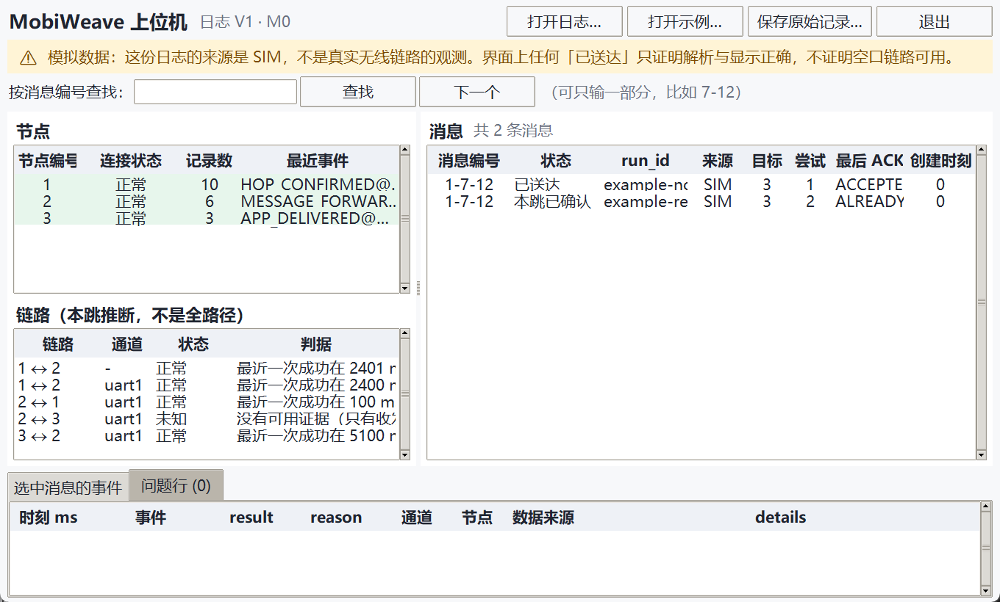
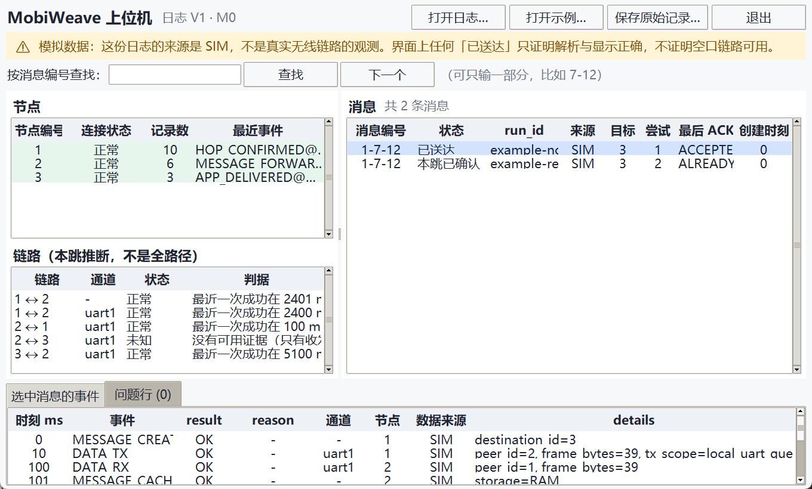
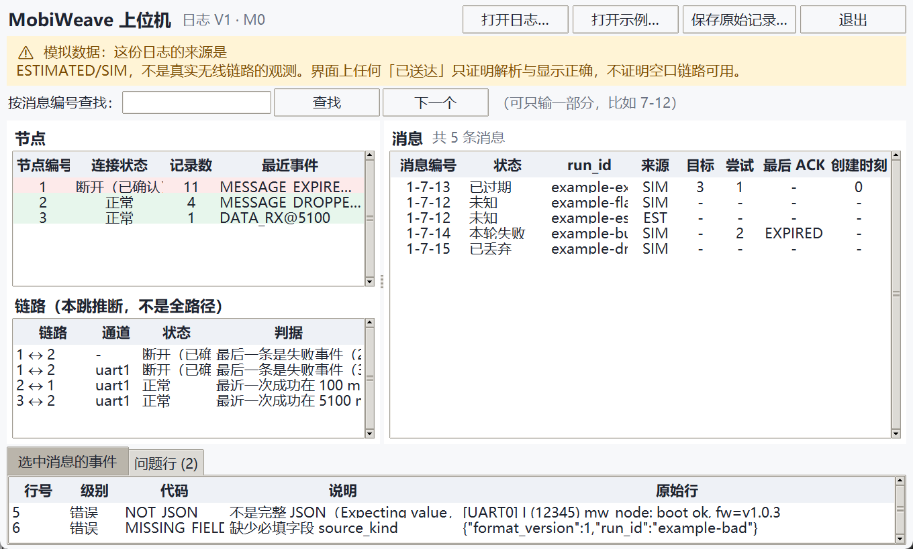

# 上位机｜D 主责

|阶段|交付|任务|
|---|---|---|
|M0，2026-11-30|读取 C 的样例日志，显示节点、消息与连接状态，保存记录；准备串口接口|[#20](https://github.com/China-wzy41/MobiWeave-Protocol/issues/20)、[#2](https://github.com/China-wzy41/MobiWeave-Protocol/issues/2)|
|M1，2026-12-31|接入真实网关，按消息编号跟踪收到、保存、转发与最终交付|[#21](https://github.com/China-wzy41/MobiWeave-Protocol/issues/21)|
|M3，2027-03-15|实验回放、逻辑拓扑和消息路径；未知、过期状态有提示|[#22](https://github.com/China-wzy41/MobiWeave-Protocol/issues/22)|

B 统一格式，C 提供模拟/统计结果，A 提供板端输入，D 负责接入、显示、保存与回放操作。先文件回放，再串口；输入适配与界面分开。技术栈在任务内记录选择依据，不在此假装已安装或已运行。

交付时补依赖版本、安装启动步骤、输入样例、预期界面、错误处理与已知限制；另一成员复现。原始日志保存到 Tests 对应 run_id。所有模拟值标明来源。

地图、轨迹和热力图后置。没有位置或测量数据时只画逻辑关系，不能制作看似真实的覆盖图。详见[协议](../docs/protocol/README.md)与[实验方法](../docs/method/README.md)。

---

## M0 现状（2026-11-23）

能导入日志 V1、按消息编号看事件链、保存原始记录并重新打开。**还没有接串口**（M1 做），现在全部走文件回放。



|能力|状态|
|---|---|
|按日志 V1 逐行解析 JSONL|已完成（含 4096 字节行长上限、UTF-8/BOM、重复键去重）|
|节点表：编号、连接状态、记录数、最近事件|已完成|
|消息表：编号、状态、run_id、来源、目标、尝试次数、最后 ACK|已完成|
|点开一条消息看创建/发送/确认/失败事件，并标数据来源|已完成|
|连接状态四态：正常 / 断开（已确认）/ 断开（推断）/ 未知|已完成|
|保存原始记录（逐行原样复制，坏行也留）并重新打开|已完成|
|坏行不崩：普通串口调试文本、坏 JSON 都保留原文继续读|已完成|
|串口实时输入|**未开始**，接口已留（见下）|
|地图 / 轨迹 / 热力图|按约定后置，M3|

### 目录

```
Host/
├─ app.py                 # 界面入口（tkinter，标准库）
├─ start_host.bat         # 双击启动
├─ mwlog/
│  ├─ records.py          # 日志 V1 逐行解析 → Record + Issue（不依赖界面）
│  ├─ state.py            # Record 聚合 → 节点 / 消息 / 链路（不依赖界面）
│  └─ selftest.py         # 25 项自检，不需要界面
├─ samples/               # 三份样例，全部是 SIM 模拟数据
└─ docs/shots/            # 界面截图（README 用）
```

**读取与界面分开**：`mwlog/` 里没有一行 `import tkinter`，所以以后串口实时输入只要产出同样的记录，界面一行都不用改。

## 环境要求

|项|实测版本|说明|
|---|---|---|
|Windows|Windows 11（26200）|macOS/Linux 应该也能跑，未实测，**待确认**|
|Python|3.12.7|3.10 及以上都行（用到了 `str | None` 写法）|
|依赖|无第三方包|只用标准库 `tkinter`、`json`、`shutil`|
|tkinter|随 Python 自带（8.6）|Windows 官方安装包默认包含|
|屏幕|≥ 1360×820|窗口默认这个尺寸，最小 1020×660|

## 启动

**方式一（推荐，给不熟命令行的人）**：双击 `Host/start_host.bat`。
脚本会 `cd` 到自己的目录，检查 `python` 是否存在，然后启动 `app.py`；也可以把日志文件拖到 `start_host.bat` 上直接打开。

**方式二（命令行）**：

```bat
cd Host
python app.py
python app.py samples\log-v1-sim.jsonl     :: 直接打开某份日志
python -m mwlog.selftest                   :: 只跑逻辑自检，不开界面
```

如果 `python` 不在 PATH 里，用完整路径，例如
`"C:\Users\<你>\anaconda3\python.exe" app.py`。

## 两分钟演示流程

1. **导入样例**：启动后点右上「打开示例…」→ 选 `log-v1-sim.jsonl` → 界面顶部出现黄色横幅
   「模拟数据：这份日志的来源是 SIM…」，左侧出现 3 个节点，右侧出现 2 条消息。
2. **查看节点和消息**：左侧节点表看编号与连接状态（绿=正常、黄=断开（推断）、红=断开（已确认）、灰=未知）；
   右侧消息表看每条消息的状态、尝试次数和最后 ACK。
3. **点开一条消息**：选中 `1-7-12`（`example-normal`）→ 下方「选中消息的事件」列出
   MESSAGE_CREATED → DATA_TX → DATA_RX → MESSAGE_CACHED → ACK_TX → ACK_RX → HOP_CONFIRMED …
   直到 APP_DELIVERED，每行都标了数据来源（SIM/REAL/EST）。
4. **按编号查找**：在「按消息编号查找」里输 `7-12` → 点「查找」→ 两条同编号的消息（正常版与重试版）
   都能点到，状态栏显示命中几条、当前第几条；按回车或「下一个」继续。
5. **保存并重新打开**：点「保存原始记录…」→ 存成 `saved-xxx.jsonl` → 弹窗问「现在重新打开吗」→ 选是，
   事件链与保存前一致（保存是**逐行原样复制**，坏行也在里面）。

坏行演示：打开 `samples\log-v1-with-bad-lines.jsonl` → 底部「问题行 (2)」里能看到两条坏行的
行号、代码（`NOT_JSON` / `MISSING_FIELD`）、说明和**原始文本**，其余记录照常解析，界面不崩。




## 界面上几个词的意思

|词|含义|
|---|---|
|**SIM**|模拟数据。日志是脚本/仿真生成的，界面上的「已送达」只证明解析和显示对，**不证明空口链路可用**。出现 SIM 或 ESTIMATED 时顶部一定有黄色横幅。|
|**REAL**|真实设备输出的日志。只有全是 REAL 时顶部才没有横幅。|
|**ESTIMATED**|估计数据（如位置估计、RSSI 估计），不能当实测证据。|
|**未知**|日志里没有足够证据判断。比如只有 DATA_TX 而没有任何 ACK/确认事件时，连接状态就是未知，**不显示成正常**。|
|**本跳已确认**|收到了这一跳的 ACK（`HOP_CONFIRMED` / `ACK_RX`）。只说明「上一跳收到」，**不等于**消息送达终点。|
|**已送达**|日志里明确出现 `APP_DELIVERED`（最终交付事件）才显示。|
|**断开（已确认）**|最后一条链路事件是 `LINK_DOWN` / `TRANSFER_FAILED`（观测到的失败）。|
|**断开（推断）**|最后一次成功事件距今超过阈值（默认 30 s，`mwlog/state.py` 里 `DEFAULT_T_DOWN_MS`）且没有新的成功证据。这是**推断**，所以和上面的颜色、文字都区分开。|

## 样例说明

|文件|用途|记录数|
|---|---|---|
|`samples/log-v1-sim.jsonl`|正常流 + 重试流 + 被拒帧 + 流超时；用来演示消息状态|19|
|`samples/log-v1-extra.jsonl`|链路 `LINK_UP`/`LINK_DOWN`、过期、丢弃、失败等边界事件|16|
|`samples/log-v1-with-bad-lines.jsonl`|上面 extra 的副本，**故意混入一条串口调试文本和一条缺字段 JSON**，用来演示坏行处理|18 行（16 有效）|

前两份是**逐字节复制的仓库样例**，来源分支 `Yanis0118-patch-1`（main 上还没有这个目录），已核对一致：

- [docs/protocol/examples/log-v1-sim.jsonl](https://github.com/China-wzy41/MobiWeave-Protocol/blob/Yanis0118-patch-1/docs/protocol/examples/log-v1-sim.jsonl)
  —— 8317 字节，sha256 前 16 位 `a312be8cb57f13e5`
- [docs/protocol/examples/log-v1-extra.jsonl](https://github.com/China-wzy41/MobiWeave-Protocol/blob/Yanis0118-patch-1/docs/protocol/examples/log-v1-extra.jsonl)
  —— 6773 字节，sha256 前 16 位 `f0f896535057b15b`

内容都是 SIM 模拟数据。以后样例进了 main 的 `docs/protocol/examples/`，可以把 `Host/samples/` 里的副本
删掉、直接从那边打开（代码不用改，`打开日志…` 指到哪份都行）。

## 对接验收：拿到新日志先跑这一条

组员的新版 `.jsonl` 到手后，别急着看界面，先跑：

```bat
cd Host
python -m mwlog.acceptance 新日志.jsonl
python -m mwlog.acceptance 新日志.jsonl --verbose    :: 连每条事件一起打出来
```

它把每条消息的关键事实列成一张表（编号 / 状态 / DATA_TX 次数 / attempt 列表 / ACK 状态 /
是否最终交付），再按 4 条规则判 PASS / FAIL：

|规则|要求|为什么|
|---|---|---|
|R1|有发送 + 有「本跳 ACK」、没有最终交付 → 必须显示**本跳已确认**|任务 #20 的口径：ACK 只证明这一跳收到|
|R2|同一个 message_id 的多次发送必须归在**一条**消息下，attempt 从 1 连续递增，最后是确认类状态|重发场景不能拆成两条消息|
|R3|只有出现 `APP_DELIVERED` 才允许显示**已送达**|不能把「发出去」当「送到了」|
|R4|没有**成功** ACK（`ACCEPTED` / `ALREADY_HAVE`）时，不能显示成已确认|`ACK` 里带 `EXPIRED`/`REJECTED` 也算失败，要落到「本轮失败」|

FAIL 的表现就是：同一份日志，我这边显示的和组员预期的对不上。**处置办法是拿同一份日志逐行对照**，
看是三件事里的哪一件：

1. 日志本身的问题（少事件、`message_id` 不一致、attempt 编号乱）→ 找生成日志的人；
2. 解析的问题（字段读错、事件名不认识）→ 看「问题行」页签，那里保留原文；
3. 显示的问题（状态优先级排错）→ 看 `mwlog/state.py` 里 `MessageView.state` 的顺序。

现在的基线（仓库样例）：

```
samples\log-v1-sim.jsonl     → 4 项 PASS（正常单跳 = 本跳已确认；重发 attempt [1,2] 归一条）
samples\log-v1-extra.jsonl   → 1 项 PASS（ACK=EXPIRED 落成「本轮失败」，没冒充确认）
```

## 错误处理

|情况|表现|
|---|---|
|不是完整 JSON（串口调试文本）|进「问题行」，代码 `NOT_JSON`，保留原文，继续读后面的行|
|缺必填字段 / 类型错 / 取值越界|进「问题行」，代码 `MISSING_FIELD`、`BAD_TYPE`、`OUT_OF_RANGE` 等，该行不产生业务记录|
|`result=OK` 却带了 `reason`|进「问题行」，代码 `REASON_ON_OK`|
|未知事件名|只提示 `UNKNOWN_EVENT`，**记录照收**，不会丢数据|
|重复的唯一键|保留第一条，提示 `DUPLICATE_KEY`|
|文件打不开 / 不是 UTF-8|弹窗说明原因，界面保持上一次的状态，不崩|
|单行超过 4096 字节|按 V1 规范拒绝该行，保留原文|

## 已知限制

1. **没有串口实时输入**。`mwlog/` 已经和界面解耦，M1 接串口时只需把串口字节流喂给
   `mwlog.records.parse_line`，界面不用改。
2. **位置、RSSI、SNR 在 V1 里没有**，所以界面上不画地图、不显示信号强度，避免编造。
3. **链路状态是「本跳」推断**，不是全路径拓扑；多跳路径要等 M3。
4. **`T_down` 阈值写死在代码里**（30 s），界面上还不能调；V1 里如果没有 `link_inferred_after_ms`
   就用这个默认值。
5. **只支持单个文件**，多份日志合并、按 run_id 对比还没做。
6. 大文件（十万行以上）未压测，目前样例都在 20 行量级。
7. Windows 以外的平台未实测。

## 相关文档

- 日志格式：[docs/protocol/log-v1.md](../docs/protocol/log-v1.md)（冻结于 2026-11-23）
- 协议草案：[docs/protocol/protocol-v1.md](../docs/protocol/protocol-v1.md)
- 任务 #20：[issue #20](https://github.com/China-wzy41/MobiWeave-Protocol/issues/20)
